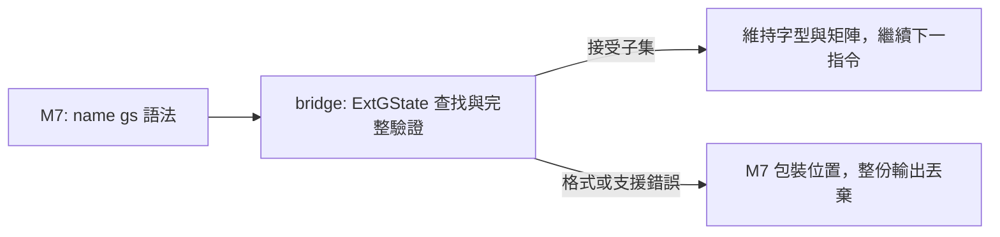

# `gs`／ExtGState 支援交接

狀態：已完成提取安全子集。2026-10-21 實作，驗收與剩餘邊界見第 11 節。

第 1–10 節保留接手時的基線與設計脈絡；第 2 節是實作前的停止點，第 5–6 節的建議介面與政策已落實。

本次任務：支援經驗證的 `gs`／ExtGState 子集，移除真實 PDF 的第一個阻擋點，並維持中文解碼、座標與錯誤處理契約。下方「事實」來自現行程式或實測；「建議」是尚未實作的設計。

## 1. 接手順序與工作區

1. 先讀根目錄 [AGENTS.md](../../AGENTS.md)，執行 `git status --short` 與 `git diff --stat`。
2. 保留既有中文功能與測試修改。交接時分支為 `main`，HEAD 為 `61df06ae90e2276c20ebd0b02c611ec17eff612e`；**HEAD 尚未包含工作區的中文功能**。以目前檔案為實作起點。
3. 讀本文件，再沿下方 how 表格確認介面；新增受控失敗測試後才修改程式。
4. 完成各層驗證與真實檔案復測，更新本文件的狀態及支援範圍。

前一階段已完成 Type0／Identity-H、ToUnicode、CID 字寬與跨頁 CMap 解壓預算，尚未提交。詳細契約與驗收見 [中文功能紀錄](../chinese-text.md)；現行介面包含：

- `pdf_text_metrics` 接收剩餘 bytes，回傳消耗長度與字寬。
- `pdf_font_context_create()` 接收可跨頁共用的 CMap 解壓計數器。
- `pdf_font_text_totals` 有 `utf8_bytes`、`events`、`cmap_bytes`。

這些是接手時的基線，不能用舊 commit 的單 byte 介面覆蓋。

## 2. 已確認的失敗與資源字典

原檔：[test_git.pdf](../../output/pdf/chinese-comparison/test_git.pdf)，479 頁，36,959,295 bytes，未加密，SHA-256：

```text
d87fdaa38f27e0a1f84601a83729506f065be9f2ce0990faee9b43642dd2ef70
```

既有 [實測報告](../../output/pdf/chinese-comparison/test_git-results/README.md) 與 [result.json](../../output/pdf/chinese-comparison/test_git-results/result.json) 保存 CLI、Poppler、耗時、hash 與截圖。原檔與報告目前是工作區的未追蹤資料；跨機器接手時先確認是否存在。

```sh
make -B pdftext
./pdftext output/pdf/chinese-comparison/test_git.pdf
./pdftext --dump-text-items output/pdf/chinese-comparison/test_git.pdf
```

兩種提取模式均為 exit 4、stdout 0 bytes，stderr：

```text
content: unsupported error at byte 3796: decoded byte 5: content operator is not supported
```

第一頁 `2 0 obj` 的 `/Resources` 指向 `482 0 R`，其中 `/ExtGState /GSa` 指向 `1919 0 R`。內容流開頭：

```text
/GSa gs /CSp cs /CSp CS
```

`gs` 的 decoded offset 為 5，下一個 `cs` 為 13。以下可直接核對資源：

```sh
./pdftext --dump-object 482 output/pdf/chinese-comparison/test_git.pdf
./pdftext --dump-object 1919 output/pdf/chinese-comparison/test_git.pdf
```

1919 的實際內容等價於：

```pdf
<< /Type /ExtGState /SM 0.02 /SMask /None
   /AIS false /SA true /ca 1 /CA 1 >>
```

Poppler 對整份文件提取成功，輸出 325,654 bytes，包含中文；首個非空文字頁為 PDF 第 3 頁。目前本工具在第一頁的 `gs` 就停止，尚未用這份文件驗證中文解碼品質。

**驗收邊界：完成 `gs` 子集不等於整份書籍提取成功。** 原始內容還有 `cs`、`CS`、路徑等未支援指令，第一頁資源也有影像 XObject。只新增 `gs` 時，預期下一個停止點是 offset 13 的 `cs`。以未修改的原始 PDF 復測並保存新拒絕點；其他指令另排功能。

## 3. how：從入口到狀態與所有權

| 層／函式 | 現行事實與 `gs` 接入位置 |
|---|---|
| [main.c](../../src/main.c) `extract_text()` | 呼叫 TextItem 提取與閱讀順序建構，全部成功後才寫 stdout／原子寫檔。 |
| [text_items.c](../../src/text_items.c) `pdf_text_items_extract()` | 逐頁讀 Contents、建立 bridge；任何頁失敗會釋放整份 TextItem collection。 |
| [pages.h](../../src/pages.h) `pdf_page.resources` | 已解析繼承的有效 Resources dictionary，借用自 document；優先用這個入口，不重走頁樹。 |
| [content_interpreter.c](../../src/content_interpreter.c) `dispatch()` | `gs` 目前在 unsupported 名單。M7 負責 operand 個數／型別、BT 與 q/Q 語法；不解析 document resource。 |
| [font_text.c](../../src/font_text.c) `visit()` | 目前先呼叫 M8，再於 Tf／Q 後重新選 active font；新增 `gs` 的資源驗證需要在呼叫 M8 **之前**分支。 |
| [text_state.c](../../src/text_state.c) `pdf_text_state_visit()` | 擁有文字參數、CTM 與 q/Q stack；`tm`／`lm` 不屬於 q/Q 保存的 graphics state。目前沒有 GS handler。 |
| [font.c](../../src/font.c) `leaf()` | 字型私有的有界 ref-chain 解析範例，包含 cycle 偵測與最近物件定位。不能直接把 private 函式當外部 API 呼叫。 |
| [document.h](../../src/document.h) `pdf_resolve()` | document 擁有 resolved objects 與 cache；ExtGState 驗證器借用物件，不自行 free。 |

M7 的 operation 與 operands 只在 callback 期間有效。第一批設計只驗證對提取沒有狀態影響的參數，因此不保留 operands，也不新增 graphics-state heap ownership。

## 4. why：原先拒絕是明定政策

[M7 plan](../archive/m7-plan.md) §關鍵決策將 `gs` 列為已知但未支援、可能改變文字或座標的指令，要求明確回報 unsupported。對應 commit 為 `5039aca`；commit 訊息本身沒有額外理由。roadmap §7 與 [M8 plan](../archive/m8-plan.md) §範圍繼續採用此政策。

規格上的實際風險是 ExtGState 的 `/Font [font-ref size]` 會改變字型與字級，其中 font 是**間接物件參照，不是 Resources 中的字型名稱**。所以刪掉 unsupported 清單中的 `gs`、把它當未知指令略過，可能產生錯誤文字與位移。這是規格風險，不是對原作者動機的推測。

## 5. 建議支援契約：先完成實測 GSa 所需子集

已依此最小子集實作，仍不代表完整 ExtGState 支援。M7 接受一個 name operand 的 `gs`；bridge 將名稱解析到有效的 `/Resources /ExtGState` dictionary，驗證所有項目後才接受。

| Key | 首批接受值 | 錯誤分類 |
|---|---|---|
| Type | 可省略；若存在為 `/ExtGState` | 錯型／錯名為 malformed。 |
| SM | 有限 number，範圍 0..1 | 錯型／超出範圍為 malformed。 |
| SA | boolean，true 或 false | 錯型為 malformed。 |
| SMask | name `/None` | 其他 name 為 malformed；dictionary soft mask 為 unsupported。 |
| AIS | boolean false | 錯型為 malformed；true 暫為 unsupported。 |
| CA、ca | 有限 number，範圍 0..1；首批只接受 1 | 錯型／超出範圍為 malformed；合法但非 1 暫為 unsupported。 |
| Font | 首批不套用 | `[font-ref finite-size]` 的合法形狀為 unsupported；錯型／錯長度為 malformed。完整支援另需設計字型身分與狀態介面。 |
| 其他 key | 首批不接受 | unsupported，包含其他標準參數與擴充 key。這是專案的保守子集政策，不宣稱是 PDF 規格要求。 |

空的合法 ExtGState dictionary 可接受；Type 不是必填。`gs` 的參數為稀疏更新，未指定項目不能重設現有文字參數。

表中接受值不改變目前提取的字元碼、字型選擇、advance 或閱讀順序。SM／SA 是繪製設定；其餘接受值是未啟用透明度／soft mask 的設定。第一批不承諾繪製其視覺效果。若之後放寬透明度或 soft mask，另寫提取可見性契約與測試。

依 PDF 規格，`gs` 可在 BT／ET 內外使用。保留本 repo 現有 q/Q/cm 限制，不把這個限制擴張套用到 `gs`。

## 6. architect：介面、替代方案與資料流

**建議採用 M7 語法分派＋bridge 的有界資源驗證**，由小模組 `src/extgstate.[ch]` 擁有 ExtGState 查找與上述欄位政策。以下為已實作的介面：

```c
/* Borrow inputs only during call; returned objects remain document-owned.
 * Validate the complete supported subset; no text/graphics-state mutation. */
int pdf_extgstate_check(pdf_document *document, const pdf_object *resources,
                       const unsigned char *name, size_t name_len,
                       const pdf_limits *limits, size_t page_offset,
                       pdf_error *error);
```

- 在 `pdf_content_operator` 末端新增 `PDF_CONTENT_GS`；operator table 加入 `{"gs", PDF_CONTENT_GS, "/", 0, 0}`，只從 unsupported 名單移除 `gs`。
- `font_text.c::bridge` 借用本頁 Resources／document／page_offset。`visit()` 遇到 GS 時先呼叫驗證器，成功直接返回；其他操作沿用原流程。
- 純 M8 `pdf_text_state_visit()`／`pdf_text_page_interpret()` 沒有 document 或 Resources，收到 GS 時仍明確回 unsupported。具有 document 的正式 bridge 才能宣稱支援。
- 純 M7 `--dump-content` 僅驗證 `gs` 語法並計入 OPS，不解析字典內容。這與現有 Tf 的分層相同；dump-content 成功不等於可提取。
- 第一批不新增快取；沿用 document object cache，對每次解析使用有界 ref-chain。若後續新增快取，按頁隔離並以 `max_container_entries` 限制。



曾比較的替代方案是給 M8 增加 resource resolver callback，讓 M8 套用一份 graphics-state patch。它適合日後支援 `/Font`，但第一批沒有文字狀態更新，現在採用會增加所有 geometry 呼叫者的遷移成本。把任意 `gs` 設成 no-op 則無法保證字型與位移，排除。

日後支援 `/Font` 時，需區分「resource-name 字型」與「直接 font-reference 字型」，同步設計 q/Q、snapshot、font handle、TextItem 診斷與快取。不要假造 `/F1` 或其他名稱來掩蓋字型身分差異。

## 7. 解析、錯誤與資源上限

- 使用 length-aware 名稱查找，涵蓋 name 中的 NUL；避免直接 `strcmp` 或回顯不可信 bytes。
- `/ExtGState`、命名 entry 與已知欄位支援 direct／indirect 值；stream 不當作一般 dictionary。每段 ref-chain 受 `max_nesting_depth` 限制，cycle 為 malformed。
- 沒有 ExtGState 資源、找不到名稱、錯型與錯誤 Type 為 malformed。超過 ref depth／數量上限為 resource limit，配置失敗為 out of memory。傳回原 resolver 錯誤，不能一律改成 unsupported。
- 驗證整份字典，包含未知 key。首批沒有文字狀態寫入，驗證失敗也不得留下半套效果。
- 所有 dictionary／array 數量與成長遵守 `pdf_limits`；所有長度與容量計算檢查 overflow。
- library 錯誤定位最近 indirect object，找不到更近位置時用 Page offset。bridge 訊息保留 `ExtGState byte N`；M7 外層仍定位 Page，附 `decoded byte N`。
- `font_text.c::wrap()` 現在硬編碼 `font byte`，不要拿它把 ExtGState 錯誤誤標成字型錯誤。
- ExtGState 不解壓新 stream，不改動 `cmap_bytes`／UTF-8／event counters。借用 document 物件的有效期止於 document close。

## 8. blast-radius：修改與回歸範圍

| 位置 | 需要改動／確認的行為 | 驗證證據 |
|---|---|---|
| content_interpreter.[ch] | GS enum、operand 名稱／個數、OPS、BT 內外 | content_interpreter_test 移除舊 `/G gs` 一律 unsupported 斷言，換成語法成功及錯型測試。 |
| extgstate.[ch]，新增 | 字典查找、欄位政策、ref／limit／定位 | 新單元測試涵蓋 direct、indirect、cycle、depth、NUL 與失敗清理。 |
| font_text.c | GS 在 M8 前驗證，active font 與矩陣不變 | bridge 測試同時核對 UTF-8、字寬與後續 origin，不只看 exit code。 |
| text_state.c／geometry callers | 沒有 resolver 時仍拒絕 GS | 裸 M8 測試，及原有 geometry goldens 不變。 |
| main.c／text_items.c | 原子輸出、錯誤位置與後頁失敗契約 | 正式 CLI、dump-items、-o 失敗保留原檔，且沒有部分 stdout。 |
| Makefile | 新模組進 SRC／HDR 及有需要的測試來源清單 | 一般、sanitizer 與 Clang 建置。檢查新增 target 的 pdf_builder.h 依賴。 |
| fixtures.tsv／golden／README／roadmap | 只更新確實支援的範圍與預期錯誤 | 目前基線是 97 筆 fixtures；原有中文與 WinAnsi 測試繼續通過。 |

安全條件是「只有已完整驗證、在此階段不影響文字狀態的字典能通過」。特別注意 `/Font`、未知 key 或軟遮罩不能因為先遇到可接受欄位而被略過。

## 9. 實作步驟與完成條件

1. **記錄新 session 基線。** 重建目前工作區、跑既有測試，確認真實 PDF 仍停在 gs。若行為已改變，先更新本文件的事實，保留既有修改。
2. **先寫失敗測試。** 用 `tests/pdf_builder.h` 或沿用 fixtures 產生器，建立含「原樣 GSa 字典＋可提取文字」的小 PDF。修改前必須在 gs 失敗。
3. **接上 M7 與 resolver。** 各層單元測試通過，只有 bridge 可以接受有效資源的 GS。原先未知指令警告與其他 unsupported 指令政策保持一致。
4. **驗證文字與狀態。** 中文／英文受控 PDF 的文字及座標，與移除 GS 的受控對照檔一致；q/Q 前後、跨 Contents、跨頁同名不同字典都符合頁面 scope。對照檔僅用於受控測試，真實原檔始終保持原樣。
5. **驗證失敗路徑。** 跑下方矩陣，確認格式、unsupported、limit 與 callback 失敗均無部分文件輸出，且不洩漏記憶體。
6. **跑完整回歸並記錄。** 最後 diff 僅含此功能；不移除既有中文功能。記錄真實 PDF 新停止點及剩餘不支援特性，不用完整書籍成功作為 gs 單項驗收條件。

| 必測情境 | 預期 |
|---|---|
| 實際 GSa、空字典、Type 省略、欄位順序變化 | bridge 接受，文字與幾何不變。 |
| name arity/type 錯誤；BT 內外各一例 | 錯誤語法 malformed；合法內外均可分派。 |
| Resources／ExtGState／entry／欄位 direct 與 indirect；共用 alias | 正確解析，無所有權錯誤。 |
| name 含 NUL、不同頁同名不同字典 | 精確名稱匹配、頁面隔離。 |
| GS 沒有 Tf 就直接顯示字串 | 仍失敗，GS 子集不能建立虛構字型。 |
| `/Font [ref size]`；合法但非 1 的 alpha；soft mask dictionary | unsupported，已發出的前頁結果全部丟棄。 |
| `/Font` 錯型、錯長度；錯型 alpha／SA；超出 SM／alpha 範圍 | malformed。 |
| ref cycle／depth 邊界、資源缺漏、stream 冒充 dictionary | 原因、錯誤分類與 object／decoded 定位正確。 |
| q/Q 嵌套、跨 Contents stream、GS 前後 Tj／TJ | 字型、字級、CTM、文字矩陣、advance 與 source order 符合對照。 |
| 後頁未知 key／unsupported Font；既有 -o 目標 | stdout／items 空白，既有檔案保留。 |

完成後執行 repo 要求的 `make test`、`make asan`，再以 Clang 驗證。這台環境曾有檔案時間差，可用 `make -B test`、`make -B asan`、`make -B CC=clang test` 強制重建。若 LeakSanitizer 因 ptrace 環境無法啟動，記錄環境原因並在允許的環境重跑，保留 leak detection。

核心測試使用已提交的小型 PDF／golden，不依賴 Poppler、Python 或 37 MB 書籍。真實 PDF 若缺失，完成受控測試並將原檔復測列為未驗證；不把真實文件寫入小型測試 fixture。

## 10. 規格來源與接手提示

[PDF 32000-1:2008](https://opensource.adobe.com/dc-acrobat-sdk-docs/pdfstandards/PDF32000_2008.pdf)：§8.2／圖 9 是操作情境；§8.4.5／表 58 定義 gs、累積更新及 Font；§10.6.3 定義 SM 範圍。原始 PDF 的定位證據見第 2 節。

下一個 session 可直接使用：

> 請依 AGENTS.md 與 docs/agents/gs-handoff.md，保留現有未提交的中文功能，完成文件建議的 gs／ExtGState 安全子集。先重現 gs 失敗，再建立受控測試，完成實作與回歸。使用未修改的 test_git.pdf 記錄新停止點；gs 通過後仍可能被 cs 等指令拒絕，請如實回報。

## 11. 實作結果與驗收

已新增 `src/extgstate.[ch]`。M7 只檢查 `name gs` 語法；正式 bridge 在 M8 之前
查找並驗證本頁的有效 Resources。接受第 5 節列出的值與空字典，完整檢查後才返回成功；
不套用文字狀態、不保留 operands、不新增 cache 或解壓計數。裸 M8 仍以 unsupported
拒絕 `gs`。`Font`、未知 key、透明度與軟遮罩的拒絕政策維持第 5 節契約。

所有查找使用名稱長度。Resources、ExtGState dictionary、entry 及已知欄位的
indirect chain 有深度上限與循環偵測，stream 不能冒充 dictionary；dictionary／
Font array 數量沿用 limits。驗證器不自行配置或釋放 document 物件；resolver 的
錯誤分類與來源 module 保留。外層錯誤含 Page byte、decoded byte 及 `ExtGState byte`，
不會誤標成 font 錯誤。

測試與基線：

- 修改前 `make -B test` 的 97 筆 fixtures 與既有中文測試通過。
- 新增 `test_gs_subset()`，實作前在原樣 GSa＋英文文字案例失敗，再接入支援。
- `tests/extgstate_test.c` 覆蓋欄位分類、direct／indirect、alias、循環、depth 邊界、
  缺漏與 stream、NUL、非有限數值、數量上限、resolver 錯誤保留及裸 M8 拒絕。
- bridge 受控對照核對中文／英文 bytes、UTF-8、字寬、origin、CTM、文字／行矩陣、
  rendering matrix、字級與文字參數、q/Q 巢狀、source order；跨 Contents 的 GS 與
  q/Q 仍維持同頁狀態。UTF-8／event／CMap counters 與不含 GS 的對照相同。
- 同名 GS 跨頁使用各頁字典；後頁 alpha、Font、錯型或未知 key 失敗時，
  TextItem 集合清空、CLI stdout／items 空白，既有 `-o` 檔案保留。
- 新增 7 份小型 PDF 與 10 筆 CLI cases，總數為 107；可用
  `python3 tests/make-gs-fixtures.py` 重建。核心測試不需要 Python、Poppler 或書籍原檔。

完整回歸已通過：`make -B test`、`make -B asan`、`make -B CC=clang test`。
ASan／UBSan／LeakSanitizer 均未報告錯誤，編譯器無 warning，`git diff --check` 通過。
Make 仍提示環境既有的 clock skew，已用 `-B` 強制重建；逗號小數 locale 未安裝，
既有 locale 檢查明示略過。fixture 產生器重跑後，7 份 PDF、7 份 golden 與 manifest
共 15 個檔案的 hash 一致。未做 allocation-failure injection；新驗證器不持有 heap
資源，間接解析仍沿用 document 的配置與清理路徑。

原始 PDF 復測：

- 未修改的 `test_git.pdf`，SHA-256 仍為
  `d87fdaa38f27e0a1f84601a83729506f065be9f2ce0990faee9b43642dd2ef70`。
- 純文字與 `--dump-text-items` 都通過 decoded byte 5 的 `gs`，改在 decoded byte 13
  的 `cs` 停止，exit 4、stdout 0 bytes。
- stderr：`content: unsupported error at byte 3796: decoded byte 13: content operator is not supported`。
- 新紀錄保存在 [test_git-gs-results](../../output/pdf/chinese-comparison/test_git-gs-results/README.md)，
  原先 `test_git-results` 的基線檔案保留。

本次沒有新增 color、path、XObject 或完整 ExtGState 支援，整份書籍的中文品質仍未驗證。

## 12. 後續 cs／CS 語法支援

依使用者後續要求，`cs`／`CS` 現在通過單一 name operand 的語法驗證後略過色彩效果。
本文件第 11 節與 `test_git-gs-results` 保留當時 gs 單項驗收；目前原始 PDF 的停止點
已從 decoded byte 13 的 `cs` 移至 byte 125 的 `scn`。詳見
[色彩空間指令的文字提取政策](../color-space-text.md) 與
[test_git-cs-results](../../output/pdf/chinese-comparison/test_git-cs-results/README.md)。
