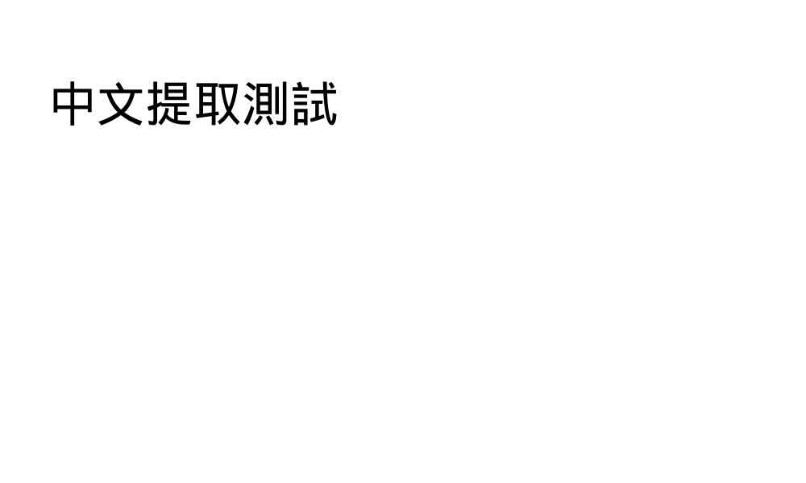

# 中文文字與實際 PDF 畫面對照

`embedded-chinese.pdf` 使用嵌入的 Droid Sans Fallback TrueType 子集、
Type0／Identity-H、CIDFontType2、Flate ToUnicode，以及依真實 hmtx 產生的 W 字寬。
字型程式可供 Poppler 實際繪製；不是將預期文字直接畫成 PNG。



本工具與 Poppler 都輸出「中文提取測試」。24pt 的六個中文字各寬 1000 units，
手算總位移為 144，`items.jsonl` 的實際 advance 也是 144。
`actual.txt`、`reference.txt`、`items.jsonl` 與 `manifest.json` 保存輸出、hash 與工具版本。

重跑：

```sh
make
python3 output/pdf/chinese-comparison/capture.py
```

需要 fontTools、Poppler 與 `/usr/share/fonts/truetype/droid/DroidSansFallbackFull.ttf`。
可用 `--font PATH` 指定包含這些中文字的 TrueType 字型。
這些工具只用於額外視覺驗收，不是核心建置與測試依賴。

PDF 內嵌字型子集由 Droid Sans Fallback 修改產生，原始字型
Copyright © 2006–2010 Google Corp.，依 Apache License 2.0 使用。
完整授權見 [FONT-LICENSE.txt](FONT-LICENSE.txt)，來源為
[Android Droid 字型](https://android.googlesource.com/platform/frameworks/base/)。
