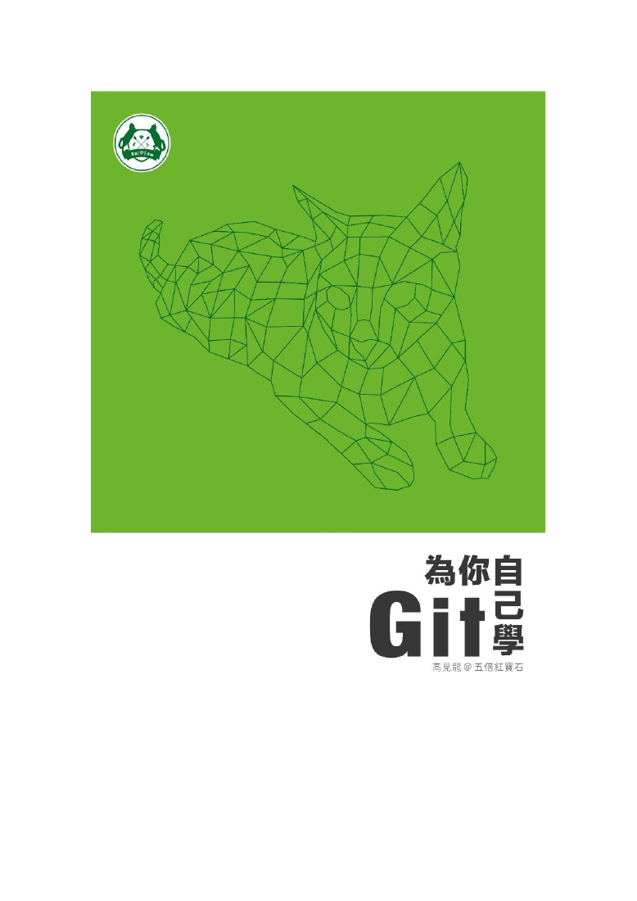

# test_git.pdf 實測結果

原檔：`../test_git.pdf`，PDF 1.4，479 頁，36,959,295 bytes，未加密。
本次強制重新建置目前的 pdftext，未修改實作或原始 PDF。

| 測試 | Exit code | stdout |
|---|---:|---:|
| make -B pdftext | 0 | 建置成功 |
| pdftext test_git.pdf | 4 | 0 bytes |
| pdftext --dump-text-items test_git.pdf | 4 | 0 bytes |
| Poppler pdftotext | 0 | 325,654 bytes |

兩個本工具的提取模式都回報：

```text
content: unsupported error at byte 3796: decoded byte 5: content operator is not supported
```

用本專案的 document、pages 與 contents API 檢查第一頁解碼後的原始內容流，開頭為：

```text
/GSa gs /CSp cs /CSp CS
```

decoded byte 5 是 `gs`，用來載入擴充圖形狀態。
`src/content_interpreter.c::dispatch()` 目前將 gs、cs、CS 與多種圖形指令列為 unsupported。
因此第一頁在文字解碼前就停止，整份文件沒有部分輸出。
這次無法以整份文件提取結果驗證中文解碼品質。

`pdffonts` 顯示 UMingCN 等嵌入的 CID TrueType、Identity-H 字型有 ToUnicode。
Poppler 的全文輸出含中文，首個非空白文字頁是 PDF 第 3 頁。
第一頁為封面圖，Poppler 沒有從第一頁提取到文字；實際畫面如下。



## 保存證據

- `result.json`：原檔與執行檔 SHA-256、指令、耗時、exit code 與輸出大小。
- `extract.stdout`、`extract.stderr`：本工具實際結果。
- `items.stdout`、`items.stderr`：TextItem 模式結果。
- `poppler.stdout`、`poppler.stderr`：Poppler 全文參考。
- `first-page-content.bin`：本專案 API 解碼出的第一頁內容流。
- `inspect-first-page.c`：讀取原始頁面內容流的診斷程式。

診斷程式以 `-iquote src` 指定本專案標頭搜尋路徑，避免遮蔽系統的 limits.h。
沒有刪除、略過或改寫 PDF 圖形指令來產生成功結果。
