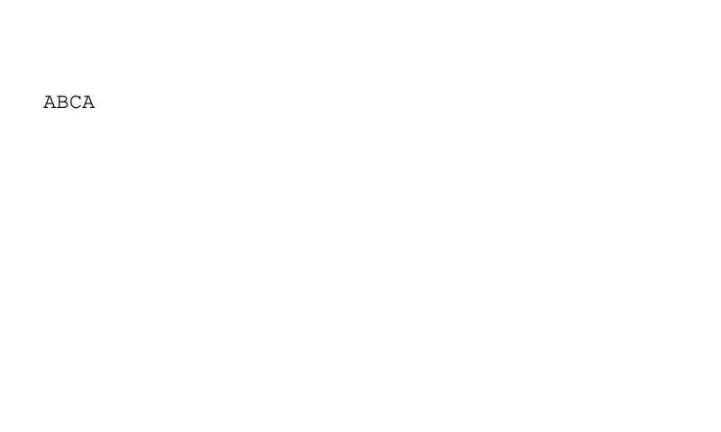

# BDC／EMC 空 ActualText 畫面與提取對照

來源是可重建的受控檔案 `tests/fixtures/marked-empty.pdf` 與
`marked-control.pdf`，兩者只有 marker 的差異。字型為明示 600 字寬的
Courier／WinAnsi，12 pt，起點 `(24, 180)`。原始字串依序為 `(A)`、`(BC)`、`(A)`。
前者以空 ActualText 包住 BC；後者移除 marker，保留相同繪圖操作。



畫面仍可見 ABCA。`empty.png` 與 `control.png` 逐 pixel 相同，沒有刪掉區段內繪圖。
raw geometry 與正式 font bridge 的來源均為本專案實際執行結果，非合成 trace。

| 原始事件 order | bytes | origin | advance x | 空 ActualText 的 TextItem |
|---:|---|---|---:|---|
| 0 | 41 | 24, 180 | 7.2 | sequence 0，A |
| 1 | 4243 | 31.2, 180 | 14.4 | 抑制，不建 item |
| 2 | 41 | 45.6, 180 | 7.2 | sequence 1，A |

上述預期直接依 `字數 × 600 / 1000 × 12` 手寫，`capture.py` 會核對真實 trace。
兩份 PDF 的裸 M8 都保留 3 個 raw events，幾何相同。正式 bridge 在空 ActualText
案例只發布 2 個 decoded events；TextItem order 為 0、2，sequence 為 0、1。

- [空 ActualText 純文字](empty-text.stdout) 是 `A A\n`。M11 依留下的幾何補空格。
- [移除 marker 的純文字](control-text.stdout) 是 `ABCA\n`。
- [raw trace](empty-raw.stdout)、[正式 bridge trace](empty-font.stdout)、
  [TextItem JSON](empty-items.stdout) 保留了原始順序、位移與抑制結果。
- Poppler 的 [空 ActualText 結果](empty-poppler.stdout) 同樣省略 BC，
  但將兩個 A 分到不同的文字行，結果為 `A\n\nA\n\n\f`。
  [control 結果](control-poppler.stdout) 是 `ABCA\n\n\f`。
  Poppler 只供比較，本專案的 golden 依自己的 M11 分行契約制定。
- 已人工檢視 PNG，文字完整且未裁切。這是受控替代字型案例，未宣稱廣泛 PDF 相容性。

重跑方式，需 Python、Pillow、Poppler；核心測試不需要它們：

```sh
python3 tests/make-marked-fixtures.py
make -B pdftext tests/geometry-test tests/font-text-test
python3 output/pdf/marked-comparison/capture.py
```

`capture.py` 同時保存 stdout、stderr、exit code，檢查手寫文字及座標預期，
並比較兩個 PNG。產生器不執行 pdftext，錯誤 golden 由測試意圖與 fixture offset 建立。

完整回歸 log：[GCC](gcc-test.log)、[Clang](clang-test.log)、
[ASan／UBSan／LeakSanitizer](asan-test.log)，三輪 exit 0，各含 133 筆 fixtures。
sanitizer 在沙箱外保留 leak detection 執行；Make 的 clock skew 以 `-B` 強制重建處理。
沒有逗號小數點 locale，既有 locale 檢查略過；沒有 allocator 故障注入證據。

原始 `test_git.pdf` 未修改，SHA-256 見 [test_git.sha256](test_git.sha256)。
[純文字](test_git-text.stderr) 與 [items](test_git-items.stderr) 復測均為 exit 4、
stdout 0 bytes，錯誤仍是 Page byte 3796、decoded byte 125 的 unsupported `scn`。
這次功能尚未被原檔執行路徑觸及，不代表已成功提取全書。原檔不納入核心測試。
